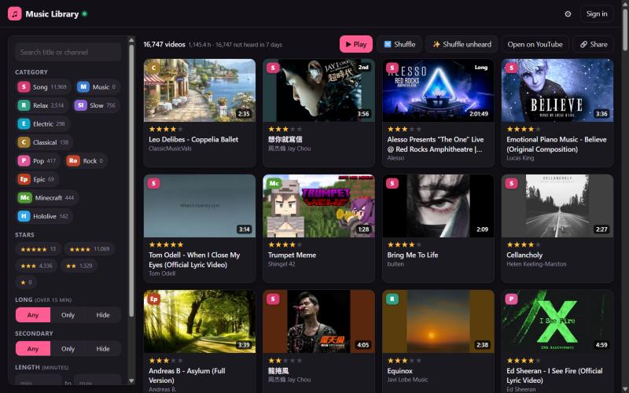

# Music Library

  
  
  

  
  

My YouTube music collection as a website anyone can open. Every song has a category, a 1–5
star rating and a couple of flairs. Pick what you're in the mood for and it plays right there.

**https://proj-yeet.github.io/yt-music-library/**

The ratings come from the **[YouTube Channel Playlist Collector](https://github.com/ProJ-Yeet/yt-channel-playlist-collector)**
userscript. Rate a song on YouTube and it appears here a second later, already sorted into its
playlist.

### Why support it

It's free and will stay free, written by one person in spare time. If you've found some good
music through it, a coffee on [Ko-fi](https://ko-fi.com/projyeet) is appreciated, never
required. Suggestions are welcome on [Discord](https://discord.gg/htkpNjk5yq).

## Using it

- **Filter** by category, stars, Long (over 15 min), Secondary, length or a search. The numbers
  on the chips tell you how many songs each choice adds.
- **▶ Play** goes in order, **🔀 Shuffle** is a plain shuffle, and **✨ Shuffle unheard** is
  explained below.
- **🔗 Share** copies a link with your filters in it. Your friend opens exactly that playlist.
- **Open on YouTube** opens the first 50 songs as a temporary YouTube playlist.
- Keys: Space to pause, ← → for previous/next, Ctrl + ← → to seek 5 s, 0–9 to jump.

Some videos aren't allowed to play outside YouTube. Those are skipped.

**On a phone** the music keeps going when you switch apps or turn the screen off, with play,
pause and next on the lock screen. Phones normally pause a page's video in the background, so the
site keeps itself awake with a silent audio track and restarts the song if the phone pauses it. If
your browser still stops it (iOS Safari does), use Brave and turn on background play in its media
settings.

**🎧 Review run** (owner only) is for going over the ratings by ear. It shuffles the songs shown
once and plays each one once, skipping ones already approved. The player shows the song's letter
and stars so you can fix them as it plays, and **✅ Approve** ticks off everything you heard in one
go. Your place in the run is kept in the browser and the approvals in the library, so you can stop
and pick it up days later. The **Reviewed** filter shows how far you are.

**🪦 Dead videos** lists songs that died on YouTube (deleted, private, blocked). They're out of
their playlist but kept here with the date, the reason and where they were, plus a link to search
for another upload. **📋 Copy report** gives the list as text. When your browser finds a video that looks dead (a blank thumbnail, or the
player refuses it), the site quietly reports it; the owner's userscript checks each report before
anything is removed. Reports can be filed by anyone but only read by the owner (see
[`firestore.rules`](firestore.rules)).

### Shuffle unheard

Songs you heard in the last 7 days (change it in ⚙) wait until everything else has played.
After that, the longer it's been since you heard a song, the more likely it is to come up.
Each song's wait is also stretched by a random 0–50%, so a batch you heard together on Monday
doesn't come back together the next Monday. What you've heard is kept in your own browser, so
everyone gets their own.

## Categories

| | | | |
|---|---|---|---|
| **S** Song (with lyrics) | **M** Music (no words) | **R** Relax (ambient, to work to) | **Sl** Slow |
| **E** Electric (EDM) | **C** Classical | **P** Pop | **Ro** Rock |
| **Ep** Epic | **Mc** Minecraft | **H** Hololive (any VTuber) | |

Flairs: **Long** (automatic past 15 minutes) and **2nd** (Secondary).

## How it works

A static page (plain JS, no build) on GitHub Pages, reading a Firestore database in real time.
Anyone can read it. Only my Google account can change it, which is enforced by
[`firestore.rules`](firestore.rules).

The library is split over 32 documents, so a visit costs about 33 reads, and Firebase's free
tier allows 50,000 a day. A song record is short: title, channel, duration, category, stars,
flairs, and which YouTube playlist it sits in.

Want your own? Make a Firebase project (Firestore + Google sign-in, with your Pages domain
authorised). Put its config in `js/firebase-config.js` and your email in `firestore.rules`,
then host the folder anywhere. Tests: `npm test`.

## Credits

- The idea of a better shuffle for YouTube playlists in a web player, and the keyboard
  shortcuts, come from [playlistShuffle](https://github.com/imagevars/playlistShuffle) by
  imagevars. No code was copied.
- [YouTube IFrame Player API](https://developers.google.com/youtube/iframe_api_reference) and
  [Firebase](https://firebase.google.com/).
- Built with help from Claude (Anthropic).

Licensed under [MIT](LICENSE).
